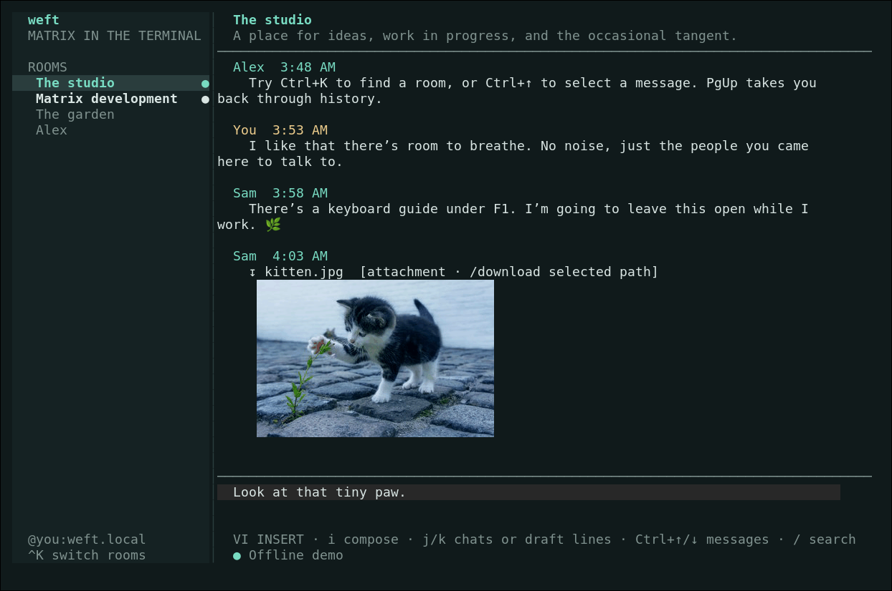

# weft

A keyboard-driven Matrix client for the terminal. It supports end-to-end encryption and keeps your conversations available offline.



## Try it

You’ll need Go 1.27.4 or later and a C compiler.

```sh
make
./bin/weft --demo
```

To sign in, run `./bin/weft login --user @you:example.org`, then `./bin/weft`. Press F1 for keyboard shortcuts.

See the [guide](docs/guide.md) for login options, configuration, and commands.

## License

Weft's code, documentation, and demo screenshots are available under the [MIT License](LICENSE). Binary archives built with `make dist` include third-party notices and links to dependency source.
